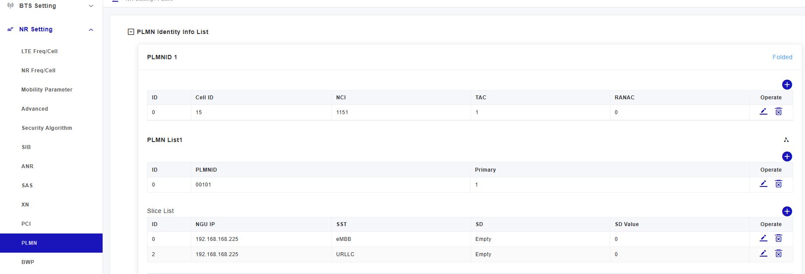
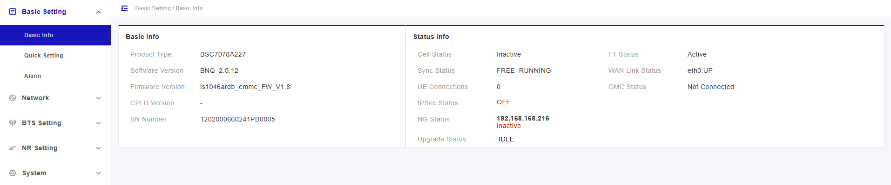
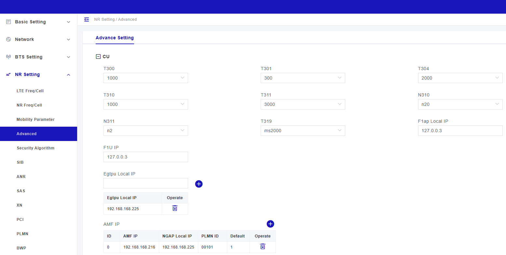
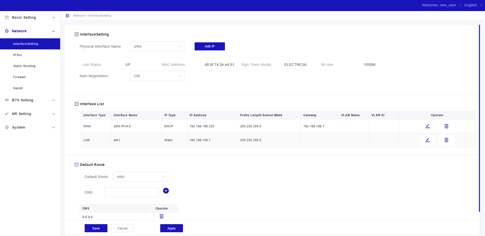
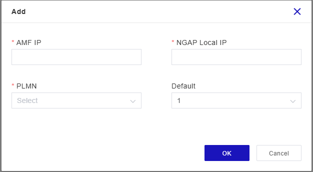
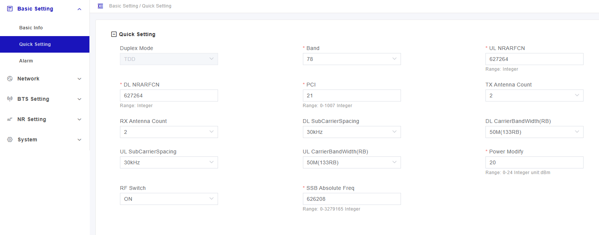

# MANUAL

## Índice

- [1. Configuración inicial](#1-configuración-inicial)
- [2. Información básica](#2-información-básica)
- [3. Configuración](#3-configuración)
  - [3.1 Configuración radio](#31-configuración-radio)
  - [3.2 Configuración conexión a core](#32-configuración-conexión-a-core)

# 1. Configuración inicial

Para acceder a la radio desde la LAN:

- Accedemos desde `192.168.150.7`.
- Configuramos la WAN → DHCP y recibimos una IP del router: `192.168.168.225`.
- También podemos acceder desde nuestra red mediante esta dirección IP.

# 2. Información básica

Acceso rápido para consultar el estado del gNB y los UE conectados.

# 3. Configuración

## 3.1 Configuración radio

Para configurar la radio accedemos a **Quick Setting**.

Configurar los parámetros de radio y del gNB:

- Banda de trabajo.
- Ancho de banda.
- Frecuencia (ARFCN).
- PCI (Physical Cell ID).

## 3.2 Configuración conexión a core

Para configurar la conexión con el core:

**NR Setting → Advanced → CU**

### Parámetros

1. **Egtpu Local IP**
   - Agregamos la IP de la radio.

2. Pulsamos el botón **"+"** y configuramos:

- **AMF IP**: IP del core.
- **NGAP Local IP**: IP de la radio.
- **PLMN**: elegir el mismo configurado en el core.

> Si el PLMN no aparece:
>
> **PLMN → Open → Add**

Desde esta misma pantalla también es posible configurar los *slices*.

> La conexión puede verificarse en la pestaña **Basic Info**.
