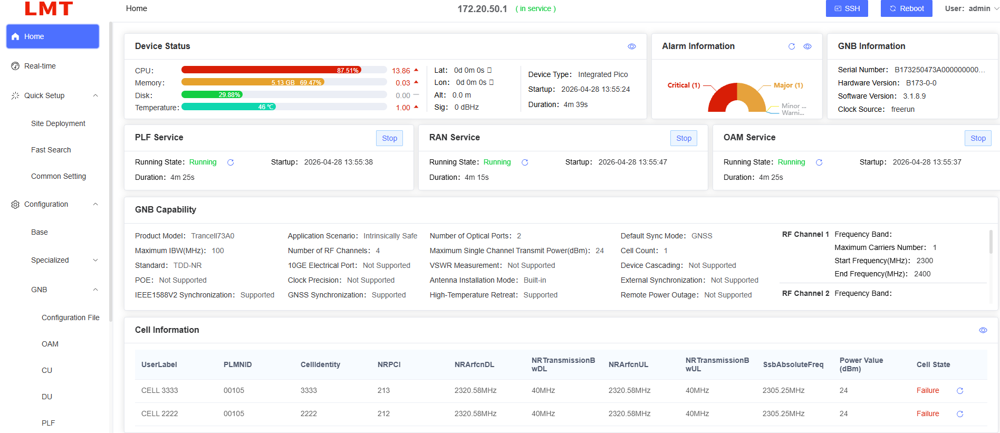
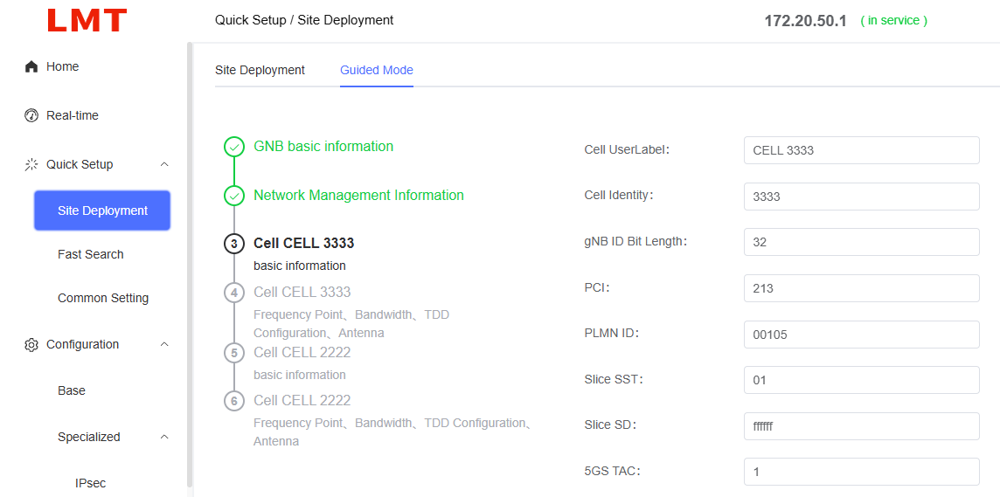
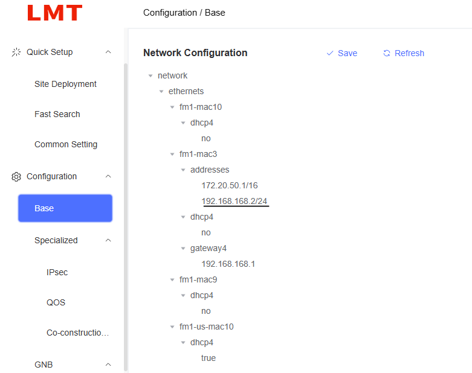
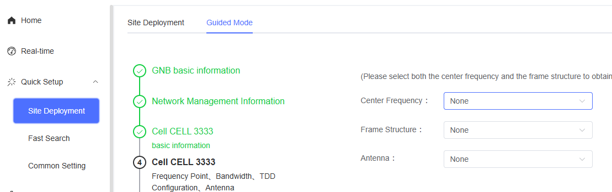
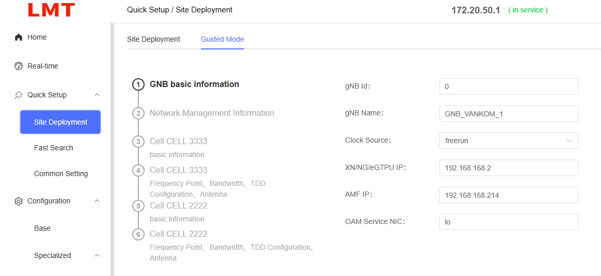

# MANUAL VANKOM 5G

## Índice

- [1. Configuración inicial](#1-configuración-inicial)
- [2. Información básica](#2-información-básica)
- [3. Configuración](#3-configuración)
  - [3.1 Configuración conexión a core](#31-configuración-conexión-a-core)
  - [3.2 Configuración celda](#32-configuración-celda)

# 1. Configuración inicial

Para acceder a la radio desde la LAN:

- Accedemos desde `172.20.50.1`.

Conectamos el ordenador a la interfaz GE de la estación base e introducimos la dirección `172.20.50.1` (por defecto) en el navegador para acceder a la página de inicio de sesión del LMT.

También es posible iniciar sesión conectando el ordenador al puerto óptico e introduciendo la dirección IP correspondiente.

En la página de login, podemos pulsar sobre **Verification Code**, introducir el nombre de usuario, contraseña y código de verificación, y finalmente pulsar **Login** para acceder al sistema LMT.

**Credenciales por defecto:**

- **Usuario:** admin
- **Contraseña:** lmt_2023

Configuramos la WAN:

# 2. Información básica

En la sección **Home** podemos consultar el estado del gNB y la información principal de la celda.

# 3. Configuración

## 3.1 Configuración conexión a core

Para configurar la conexión con el core accedemos a:

**Quick Setup → Guided Mode**

Configurar:

- **eGTPU:** introducir la IP de la radio.
- **AMF IP:** introducir la IP del core.

## 3.2 Configuración celda

### Paso 3

Podemos modificar los siguientes parámetros:

- PCI
- PLMN
- SST
- SD
- TAC

> ⚠️ **Importante:** El PLMN y el TAC deben coincidir con los configurados en el Core.
>
> ⚠️ El valor `SD ffffff` corresponde al slice configurado por defecto.

### Paso 4

Configurar los parámetros de radio y del gNB:

- Ancho de banda
- Frecuencia

