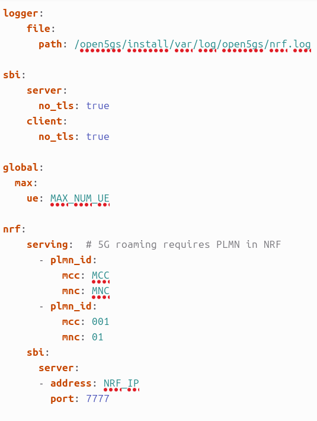

# INSTALAR Open5GS CURSO 2025/2026

> **Importante:** Si la máquina virtual se crea en Proxmox, confirmar que:
>
> **Processor → Type → host**

## Índice

- [1. Instalación de Docker y Portainer](#1-instalacion-de-docker-y-portainer)
- [2. Instalación de Open5GS](#2-instalacion-de-open5gs)
- [3. Roaming Open5GS](#3-roaming-open5gs)
- [4. Separar UPF Open5GS](#4-separar-upf-open5gs)

# 1. Instalación de Docker y Portainer

Accedemos al repositorio:

<https://github.com/Tknika/5g-kutxa-ansible/tree/portainer>

Ejecutamos los pasos indicados.

### Instalar Ansible

```bash
sudo apt update && sudo apt install -y ansible git
```

### Instalar Docker y Portainer

```bash
sudo ansible-pull -U https://github.com/Tknika/5g-kutxa-ansible.git --checkout portainer -i localhost,
```

Reiniciar el equipo para aplicar correctamente la pertenencia al grupo Docker:

```bash
reboot
```

### Verificación

Comprobar que Docker está funcionando:

```bash
docker ps
```

O acceder a:

```text
https://localhost:9443
```

# 2. Instalación de Open5GS

Accedemos al repositorio oficial:

<https://github.com/herlesupreeth/docker_open5gs>

### Descargar repositorio

Instalar Git:

```bash
sudo apt install git
```

Clonar el repositorio:

```bash
git clone https://github.com/herlesupreeth/docker_open5gs
```

### Descargar imágenes Docker

En este caso solamente descargamos Open5GS y componentes asociados, sin IMS.

#### Open5GS

```bash
docker pull ghcr.io/herlesupreeth/docker_open5gs:master
docker tag ghcr.io/herlesupreeth/docker_open5gs:master docker_open5gs
```

#### Grafana

```bash
docker pull ghcr.io/herlesupreeth/docker_grafana:master
docker tag ghcr.io/herlesupreeth/docker_grafana:master docker_grafana
```

#### Metrics

```bash
docker pull ghcr.io/herlesupreeth/docker_metrics:master
docker tag ghcr.io/herlesupreeth/docker_metrics:master docker_metrics
```

### Configuración previa

Editar el fichero `.env` y configurar:

- MCC
- MNC
- TAC
- DOCKER_HOST_IP (IP del equipo donde se realiza la instalación)

Aplicar los cambios:

```bash
set -a
source .env
```

### Desplegar Core 5G Stand Alone

Levantar el despliegue completo:

```bash
docker compose -f sa-deploy.yaml up -d
```

### Verificación

Comprobar desde Portainer que todos los contenedores se han levantado correctamente.

# 3. Roaming Open5GS

Para poder trabajar con varias radios dentro de la misma aula:

- El Core y la radio trabajarán en un PLMN (por ejemplo `00110`).
- El terminal móvil se conectará utilizando otro PLMN (por ejemplo `00101`).

### Pasos

#### 1. Conectar Core y radio

Configurar tanto el Core como la radio con:

```text
PLMN = 00110
```

#### 2. Crear abonado

Agregar en la WebUI un usuario utilizando:

```text
PLMN = 00101
```

#### 3. Configurar NRF

Editar el fichero:

```text
nrf.yaml
```

y realizar la configuración correspondiente.



# 4. Separar UPF Open5GS

## Equipo donde actualmente está instalado el UPF

### Paso 1. Crear nuevo compose

Copiar:

```text
sa-deploy.yaml
```

como:

```text
core-sinUPF.yaml
```

### Paso 2. Modificar core-sinUPF.yaml

- Comentar o eliminar toda la sección correspondiente al UPF.
- Añadir en el servicio SMF:

```yaml
ports:
  - "8805:8805/udp"
```

### Paso 3. Modificar .env

```text
DOCKER_HOST_IP=IP_DEL_CORE
UPF_IP=IP_DEL_UPF
UPF_ADVERTISE_IP=IP_DEL_UPF
```

### Paso 4. Levantar servicios

```bash
docker compose -f core-sinUPF.yaml up -d
```

## Equipo donde se instalará el nuevo UPF

### Paso 1. Crear nuevo compose

Copiar:

```text
sa-deploy.yaml
```

como:

```text
UPF2.yaml
```

### Paso 2. Modificar UPF2.yaml

- Comentar o eliminar todos los servicios excepto el UPF.
- Configurar la red en modo host.
- Eliminar la sección `sysctls`.

### Paso 3. Modificar .env

```text
DOCKER_HOST_IP=IP_DEL_UPF
UPF_IP=IP_DEL_UPF
UPF_ADVERTISE_IP=IP_DEL_UPF
SMF_IP=IP_DEL_CORE
```

### Paso 4. Levantar servicios

```bash
docker compose -f UPF2.yaml up -d
```

## Verificación final

Comprobar desde Portainer que:

- El Core está operativo.
- El SMF escucha en UDP 8805.
- El UPF se registra correctamente contra el SMF.
- Todos los contenedores aparecen en estado `running`.
